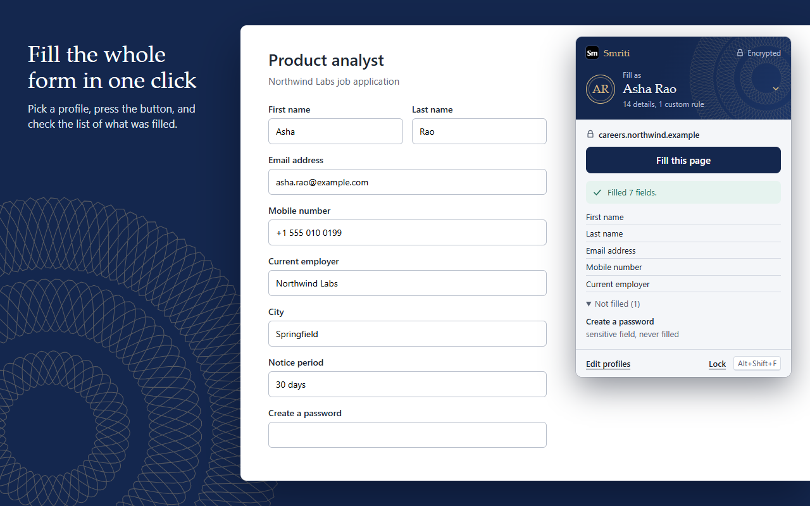
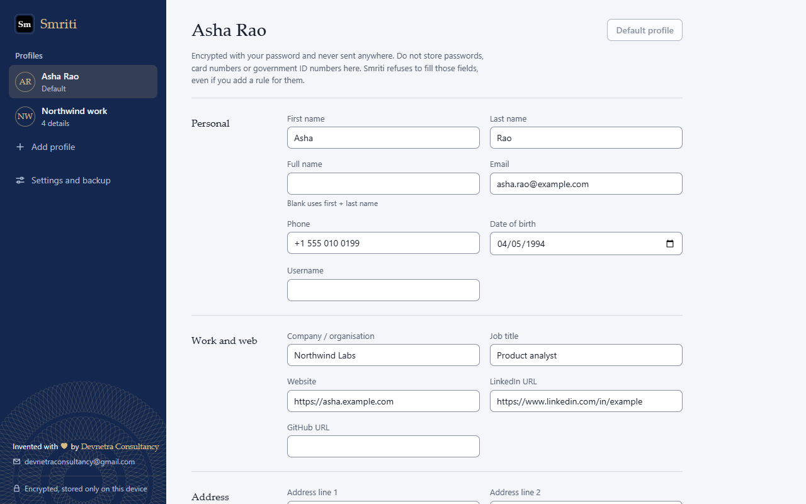
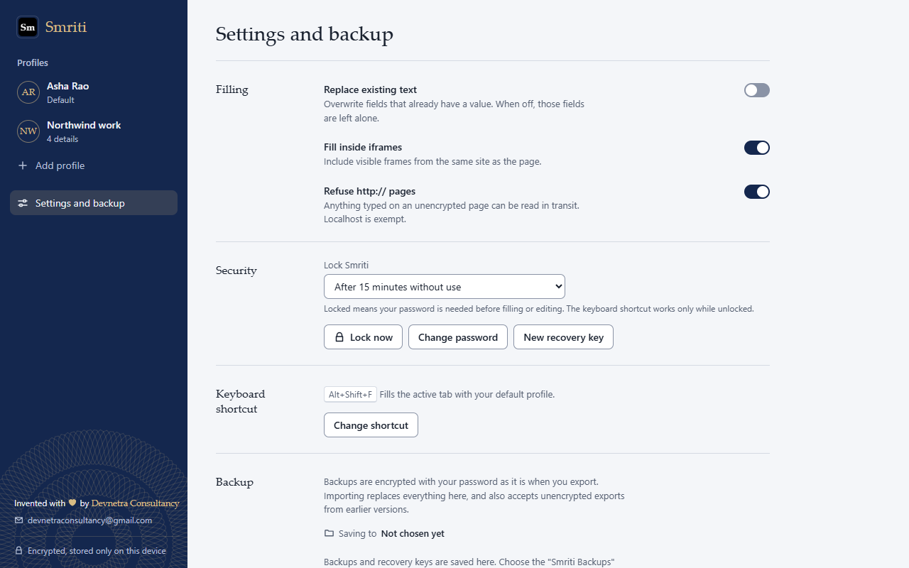

<p align="center">
  
</p>

<h1 align="center">Smriti</h1>

<p align="center">
  <strong>स्मृति · "memory"</strong><br>
  The private form filler that remembers you, and forgets nothing to anyone else.
</p>

<p align="center">
  <em>Crafted by <strong>Devnetra Consultancy</strong></em>
</p>

<p align="center">
  AES-256 encrypted &nbsp;·&nbsp; No account &nbsp;·&nbsp; No servers &nbsp;·&nbsp; No network access &nbsp;·&nbsp; 60 KB
</p>



---

## Stop typing your life story into every form

Job applications. Sign-ups. Delivery addresses. Visa portals. Every one asks for the same name, email, phone, date of birth,
employer and address, and every time you type it all again.

**Smriti fills the whole form in one click**, from profiles you keep on your own computer, locked with your own password.
Nothing is uploaded, synced or shared. Ever.

## Why people choose Smriti

| | |
| --- | --- |
| ⚡ **One click, or one shortcut** | Press **Fill this page** or **Alt+Shift+F**. Done in a blink. |
| 🧠 **Understands real forms** | Reads labels, placeholders, autocomplete hints and nearby text. Works with React, Vue and Angular sites, dropdowns, date pickers, shadow DOM and same-site frames. |
| 👥 **Up to 20 profiles** | Personal, work, family, a parent's details. Switch in one tap. |
| 🎯 **Custom rules** | Teach it the odd ones: *notice period*, *expected CTC*, *PIN code*, whatever your forms ask. |
| 🔐 **Encrypted with your password** | AES-256-GCM, with your key derived through 600,000 rounds of PBKDF2. Locked data on disk is unreadable. |
| ⏱️ **Locks itself** | After 5, 15 or 60 minutes idle, when Chrome closes, or after every single fill. Your choice. |
| 🗝️ **Recovery key** | Forgot your password? Your recovery key gets you back in. |
| 💾 **Encrypted backups** | Saved straight to your **Smriti Backups** folder, protected by your password. |
| 🌗 **Beautiful in light and dark** | A calm, passport-inspired design that feels at home on any screen. |



## Built to say "no"

A form filler is only as safe as what it refuses to do. Smriti is deliberately stubborn:

- **Never** fills passwords, card numbers, CVVs, one-time codes or government ID fields, not even through a custom rule.
- **Never** fills fields you cannot see. Hidden, transparent, covered, tiny and off-screen fields, and invisible iframes,
  are treated as traps and skipped.
- **Never** ticks checkboxes or radio buttons, so it can't accept terms or consent on your behalf.
- **Refuses** unencrypted `http://` pages by default, and **warns** you when a form would send your details to another site.
- **Leaves** your existing text alone unless you switch on overwrite.
- **Shows** exactly which fields were filled, and why any were skipped, without ever displaying your values.

## Private by design, not by promise

- Runs **only** when you click it or press the shortcut, and **only** on the tab in front of you.
- Needs **no** permission to read your browsing history or "all websites".
- The extension's security policy **blocks all network access**. There is no server to send anything to.
- No account. No analytics. No ads. No tracking.



## Install

1. Download **`Smriti-2.3.0.zip`** and unzip it. You get two folders:

   ```
   Smriti/            the extension
   Smriti Backups/    where your backups and recovery key are saved
   ```

2. Open `chrome://extensions` and switch on **Developer mode** (top right).
3. Click **Load unpacked** and choose the **Smriti** folder.
4. Pin Smriti from the puzzle-piece menu.
5. Set your password, then save your recovery key. When Smriti asks for a folder, choose **Smriti Backups**.

That's it. Open any form and click **Fill this page**.

> Keep the `Smriti` folder where it is after loading it. Chrome runs the extension from that folder.

## Backups that stay yours

**Settings and backup > Export encrypted backup** saves a `.smriti` file to your **Smriti Backups** folder. It opens only
with the password you used when you made it. **Import backup** restores it on any computer, and also accepts files from
earlier versions. Copy the folder to a USB drive and your profiles are safe even if your computer isn't.

## FAQ

**What happens if I forget my password?**
Use your recovery key on the unlock screen. If you lose both, nobody can decrypt your data, including us. That is the point.

**Can websites read my profiles?**
No. A page only ever sees the fields Smriti fills on it, the same as if you had typed them.

**Does it work offline?**
Completely. Smriti never goes online.

**Which browsers?**
Google Chrome 111 or newer, and other Chromium browsers such as Edge and Brave.

## About Devnetra Consultancy

Smriti is designed and built by **Devnetra Consultancy**, crafting thoughtful, privacy-first software.

📧 **[devnetraconsultancy@gmail.com](mailto:devnetraconsultancy@gmail.com)** for support, feedback, partnerships or licensing.

If Smriti saves you time, tell a friend who fills in a lot of forms.

## License

Copyright © 2026 Devnetra Consultancy. All rights reserved.
Smriti is proprietary software. See [LICENSE](LICENSE). Copying, modifying or redistributing any part without written
permission is prohibited.

---

<details>
<summary><strong>For developers</strong></summary>

| Path | What it is |
| --- | --- |
| `form-filler/` | The extension source. It keeps its pre-Smriti folder name because Chrome ties an unpacked extension's identity, and so its stored data, to the folder path. The release zip names it `Smriti/`. |
| `tests/` | Unit tests (jsdom) and adversarial browser tests (real Chrome). |
| `tools/` | Generates icons and store images, and builds both zips. |
| `store-assets/` | Store screenshots and promo tiles, rendered from the real UI with fictional data. |
| `docs/` | Security audit, store listing copy, privacy policy. |

Needs Node 22+ and Chrome.

```bash
npm install
```

```bash
npm test
```

```bash
npm run test:e2e
```

```bash
npm run package
```

`npm run package` writes `dist/Smriti-<version>.zip` (the two-folder release) and `dist/smriti-<version>-webstore.zip`
(the Chrome Web Store upload), and refuses to include unexpected file types. `npm run assets` regenerates the icons and
`npm run store-assets` the store images. The full threat model is in [docs/SECURITY_AUDIT.md](docs/SECURITY_AUDIT.md).

</details>
