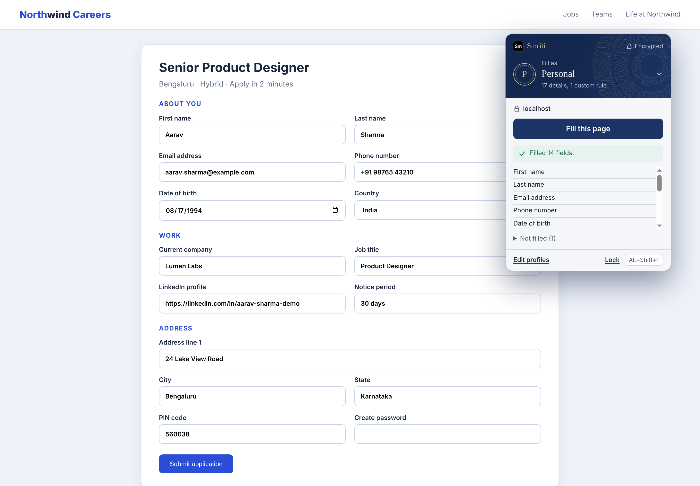
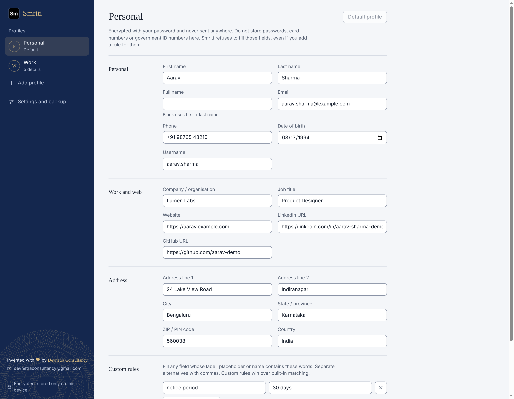
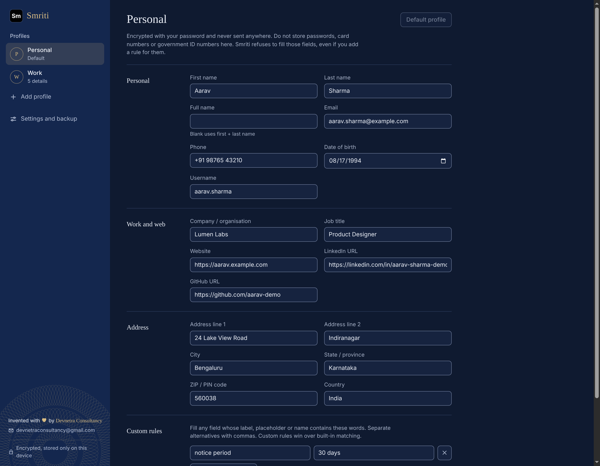
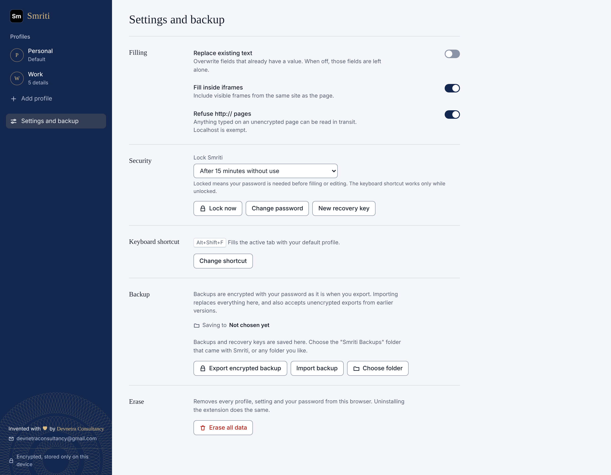
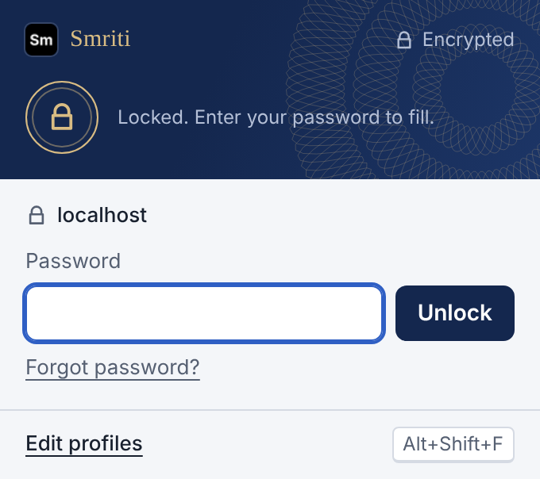

  

<h1 align="center">Smriti</h1>

  <strong>स्मृति · "memory"</strong> 
  The private form filler that remembers you, and tells no one else.

  
  
  
  
  
  

  
  
  

  

---

## Stop retyping the same details

Name, email, phone, address, employer. Every form asks again.

**Smriti fills the whole page in one click** from profiles stored only on your computer, locked with your own password.
Nothing is uploaded, synced or shared.

> **Example:** open a job application, press **Alt+Shift+F**. In the screenshot above, 14 fields were filled in one click.

## What you get

| | Feature | What it means |
| --- | --- | --- |
| ⚡ | **One click or shortcut** | **Fill this page** or **Alt+Shift+F**. |
| 🧠 | **Reads real forms** | Labels, placeholders, autocomplete hints. Works with React, Vue, Angular, dropdowns, date pickers, shadow DOM. |
| 👥 | **Up to 20 profiles** | Personal, Work, Family. Switch in one tap. |
| 🎯 | **Custom rules** | Teach it odd fields. *Example: "notice period" → "30 days".* |
| 🔐 | **AES-256-GCM** | Key derived with 600,000 PBKDF2 rounds from your password. |
| ⏱️ | **Auto-lock** | After 5, 15 or 60 minutes, on Chrome close, or after every fill. |
| 🗝️ | **Recovery key** | Forgot your password? The key gets you back in. |
| 💾 | **Encrypted backups** | `.smriti` files, readable only with your password. |
| 🌗 | **Light and dark** | Passport-inspired design. |

  
  

## Built to say no

| Smriti never... | Why |
| --- | --- |
| fills passwords, card numbers, CVVs, OTPs or government IDs | Even a custom rule cannot override this. |
| fills hidden, transparent, tiny or off-screen fields | Those are bot traps. |
| ticks checkboxes or radio buttons | It can't accept terms for you. |
| fills `http://` pages (default) | Typed data can be read in transit. |
| overwrites your existing text (default) | Opt in from Settings. |

In the demo run, the **Create password** field was left empty on purpose.

## Private by design

- Runs **only** when you click, and **only** on the tab in front of you.
- No "read all websites" or browsing-history permission. Only `storage`, `activeTab`, `scripting`, `alarms`.
- The security policy **blocks all network access**. No server exists to send data to.
- No account. No analytics. No ads.

  

## Install in 1 minute

1. Click **Code → Download ZIP** on this page, then unzip it.
2. Open `chrome://extensions` and turn on **Developer mode** (top right).
3. Click **Load unpacked** and select the unzipped folder (the one containing `manifest.json`).
4. Pin Smriti from the puzzle-piece menu.
5. Set a password and save your recovery key.

Then open any form and click **Fill this page**.

> Keep the folder in place after loading. Chrome runs the extension from it.

  

## FAQ

**I forgot my password.** Use your recovery key on the unlock screen. If you lose both, nobody can decrypt your data, including us.

**Can websites read my profiles?** No. A page only sees the fields Smriti fills, as if you typed them.

**Does it work offline?** Yes. It never goes online.

**Which browsers?** Chrome 111+, and Chromium browsers such as Edge and Brave.

## Devnetra Consultancy

<table>
  <tr>
    <td></td>
    <td>
      <strong>Devnetra Consultancy</strong> 
      Thoughtful, privacy-first software. 
      📧 <a href="mailto:devnetraconsultancy@gmail.com">devnetraconsultancy@gmail.com</a> for support, feedback, partnerships or licensing.
    </td>
  </tr>
</table>

If Smriti saves you time, tell a friend who fills in a lot of forms.

## License

Copyright © 2026 Devnetra Consultancy. All rights reserved. Proprietary software, see [LICENSE.txt](LICENSE.txt).
Copying, modifying or redistributing any part without written permission is prohibited.

---

<strong>For developers</strong>

| File | Purpose |
| --- | --- |
| `manifest.json` | MV3 manifest, strict CSP (`connect-src 'none'`) |
| `background.js` | Service worker: shortcut and auto-lock alarms |
| `popup.html` / `popup.js` | Toolbar popup: unlock, pick profile, fill |
| `options.html` / `options.js` | Profile editor, settings, backup |
| `filler.js` | Field detection and filling engine |
| `vault.js` | AES-256-GCM vault, PBKDF2, recovery key |
| `xlsx.js` | Import of spreadsheet exports |
| `docs/screenshots/` | Real screenshots, fictional data |

No build step. Load the folder unpacked.

